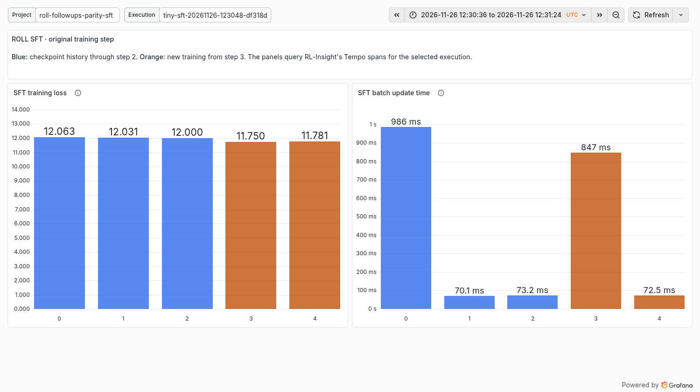

## Problem

The SFT driver could resume its step counter and metric history from `WorkerState`, but its training worker did not load the matching model checkpoint. The driver also did not drain the tracker on exit, including when there were no new batches.

## Scope

Enable the optional RL-Insight driver tracker for `examples/start_sft_pipeline.py`, using the same finish path as text RLVR. When resuming, workers load the same checkpoint URI the driver chose. They do not independently pick a newer one. Explicitly selected FSDP2 state must be visible to all ranks. Fresh runs and the default TensorBoard selection are unchanged. The tracker adds no worker traces, hardware samples, or payloads from training data.

## Where to review

Start with the SFT driver constructor, run wrapper, and worker initialization in `roll/pipeline/sft`. Then read the shared replay/finish path in `roll/pipeline/base_pipeline.py`, followed by the worker checkpoint regression and opt-in Tempo integration.

## Verification

- **CPU** — 35 passed on `31a1730`, including real Ray/Tempo with synthetic metrics, the constructor and failure paths, and an interrupted resume before the first new step. The worker checkpoint tests failed before the fix because the worker never attempted the load and did not surface its failure.
- **Real training and restart** — Standard SFT entry on one RTX A6000, BF16 two-layer Qwen2 with FSDP2. A fresh process loaded DCP from `checkpoint-2` before training only new batches 3–4. A separate default run with SDK imports blocked wrote TensorBoard steps 0–2. The existing FSDP2/DCP implementation did not restore AdamW state in this environment.
- **Service readback** — Tempo matched all 41 first-run metrics and all 70 resumed-run metrics by name, value, and original step, including all 17 points at step 4. The CPU resume interrupted after initialization also retained checkpoint history through step 2.

Tested with PyTorch 2.11.0+cu130 for training and 2.8.0+cpu for CPU tests, Ray 2.48.0, RL-Insight SDK and server `bef6181dcaadc8e643697200c829b875461fefba`, and Tempo 2.6.1.

## Grafana

SFT loss and batch-update time from the actual resumed execution. Blue is checkpoint history (steps 0–2). Orange is new training (steps 3–4). Step 4 is visible after the driver has exited.

[Dashboard JSON](dashboards/sft-grafana.json) · [Exact values and point counts](Readback.md#sft) · [Reproduce the figure](README.md#reproduce-the-figure)

Depends on alibaba/ROLL#529.
