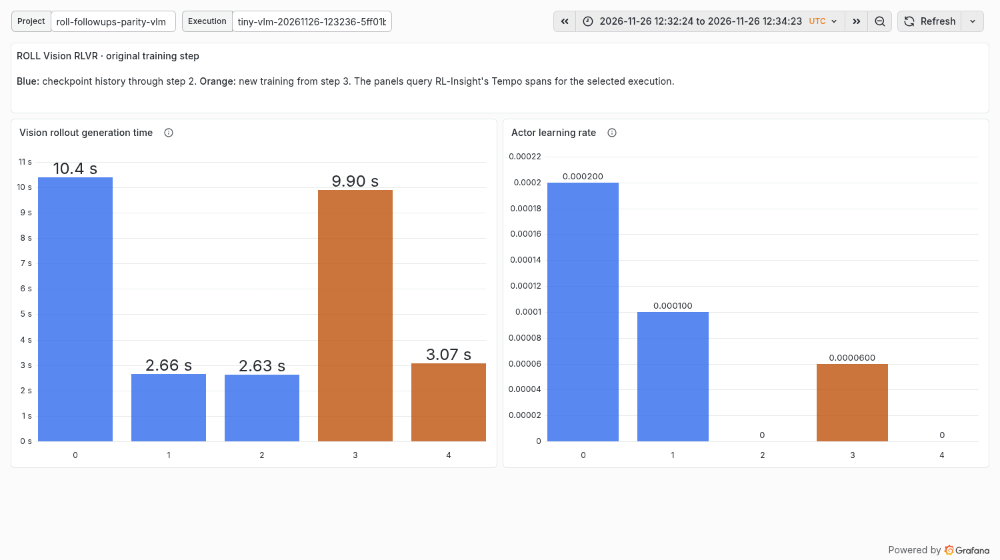

## Problem

Vision RLVR has its own training entry and run loop. It needs the same tracker teardown and history replay guarantees as text RLVR. The previous loop returned after scheduler shutdown without flushing the driver tracker.

## Scope

Enable the optional RL-Insight driver tracker for `examples/start_rlvr_vl_pipeline.py`, using the shared replay wait and flush on normal exit, constructor failure, and training or scheduler errors. Keep the existing checkpoint-before-log order in both the normal and zero-valid-response branches. Do not change rollout-only drivers or send images, prompts, worker traces, or hardware samples. TensorBoard remains the default.

## Where to review

Start at the constructor and run wrapper in `roll/pipeline/rlvr/rlvr_vlm_pipeline.py`, then check the parameterized lifecycle regressions and the vision case in `tests/pipeline/test_rl_insight_integration.py`.

## Verification

- **CPU** — 44 passed on `e8bf333` across the stacked branches, including genuine Ray/Tempo checks for normal resume, replay-only exit, and interruption before the first new step.
- **Real training and restart** — Standard vision entry on one RTX A6000 with BF16 two-layer Qwen2.5-VL, actual image inputs, vLLM rollout, math rewards, and FSDP2 actor updates. A new process loaded the DCP from `checkpoint-2` and ran only steps 3–4. The default TensorBoard run wrote step 0 with SDK imports blocked. The existing DCP-AdamW restoration limitation remains.
- **Service readback** — After exit, Tempo matched 668 first-run metrics and 1,115 resumed-run metrics by name, value, and original step. The recovered execution includes historical steps 0–2 and all 226 points from step 4. In a separate real rollout with zero valid response tokens, both skipped steps were visible in Tempo after exit.

Tested with PyTorch 2.11.0+cu130 for training and 2.8.0+cpu for CPU tests, Ray 2.48.0, vLLM 0.20.1, RL-Insight SDK and server `bef6181dcaadc8e643697200c829b875461fefba`, and Tempo 2.6.1.

## Grafana

Vision rollout time and actor learning rate from the actual resumed execution. Blue is checkpoint history (steps 0–2). Orange is new training (steps 3–4). Step 4 is visible after the driver has exited.

[Dashboard JSON](dashboards/vision-grafana.json) · [Exact values and point counts](Readback.md#vision-rlvr) · [Reproduce the figure](README.md#reproduce-the-figure)

Depends on the SFT follow-up and alibaba/ROLL#529.
